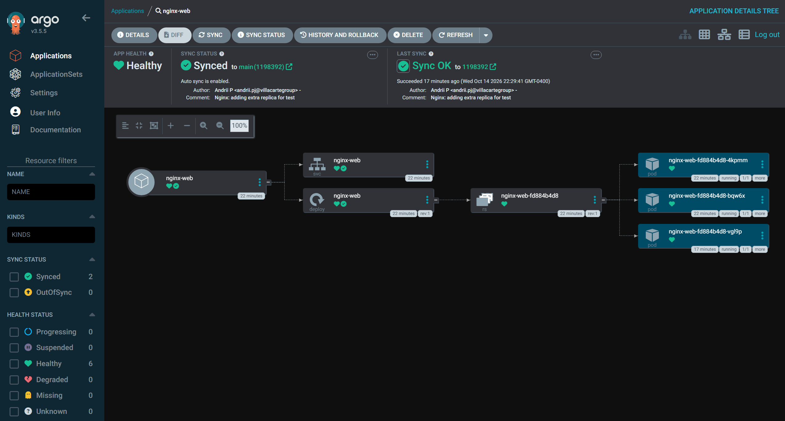

# k3s GitOps Homelab

A Kubernetes homelab demonstrating GitOps-based application delivery using k3s and Argo CD.

## Screenshots

### Argo CD Dashboard



## Overview

This project demonstrates declarative Kubernetes application management, automated synchronization from Git, and continuous reconciliation using Argo CD.

## Architecture

GitHub Repository → Argo CD → k3s Cluster → NGINX Deployment

- **k3s** — lightweight Kubernetes distribution.
- **Argo CD** — GitOps continuous delivery and reconciliation.
- **Kustomize** — organizes Kubernetes application manifests.
- **NGINX** — sample workload used to validate deployments.

## Repository Structure

```text
.
├── apps/
│   └── nginx-web/
│       ├── deployment.yaml
│       ├── service.yaml
│       └── kustomization.yaml
├── clusters/
│   └── homelab/
│       └── nginx.yaml
└── README.md
```

## GitOps Workflow

1. Update Kubernetes manifests in Git.
2. Commit and push changes to GitHub.
3. Argo CD detects repository changes.
4. Argo CD synchronizes the desired state with the Kubernetes cluster.
5. Kubernetes reconciles the workload.

## Current Implementation

- k3s Kubernetes cluster
- Argo CD application management
- Automated synchronization from a Git repository
- Self-healing configuration
- NGINX Deployment and ClusterIP Service
- Declarative application manifests

## Verification

```bash
kubectl get applications -n argocd
kubectl get deployments -n nginx-web
kubectl get pods -n nginx-web
kubectl get services -n nginx-web
```

## Planned Improvements

- CI pipeline with GitHub Actions
- Jenkins and Maven build pipeline
- Container image build and vulnerability scanning
- Helm or Kustomize environment overlays
- Prometheus and Grafana monitoring
- Ingress configuration with Traefik

## Goals

The goal of this project is to practice Kubernetes operations, GitOps workflows, CI/CD automation, and infrastructure observability.
