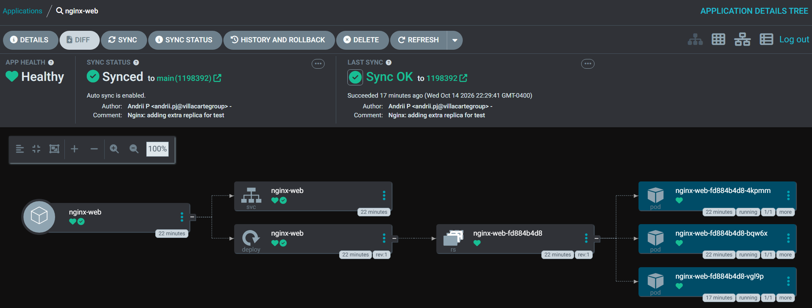

# k3s-gitops-homelab
Production-inspired Kubernetes homelab built on k3s, using Argo CD for GitOps, GitHub Actions for CI/CD, Prometheus and Grafana for observability, and automated security scanning.

## Screenshots

### Argo CD Dashboard

